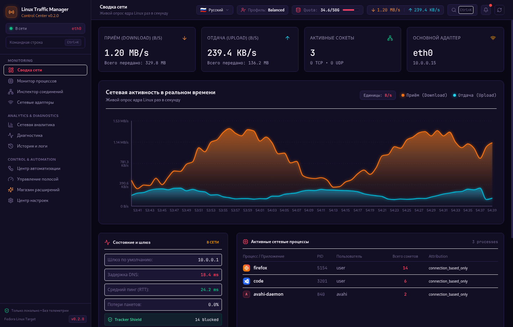
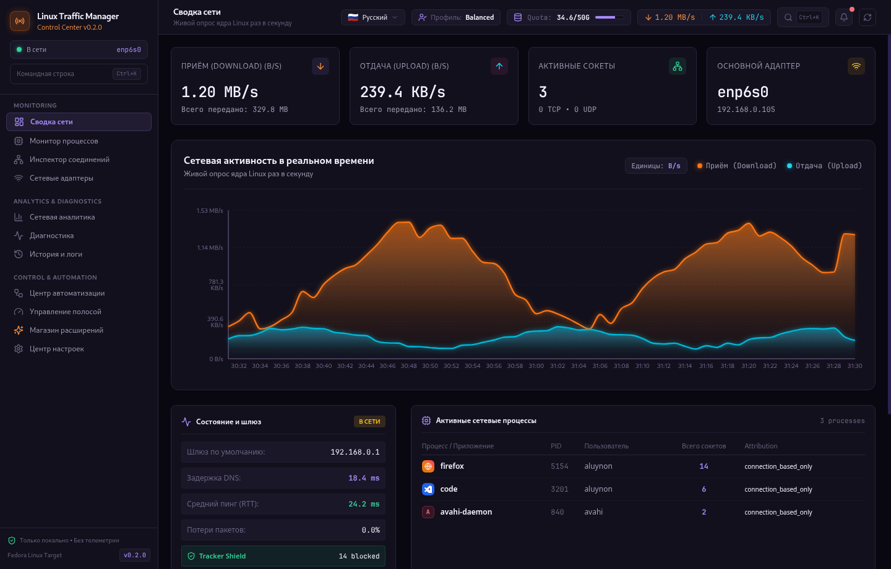
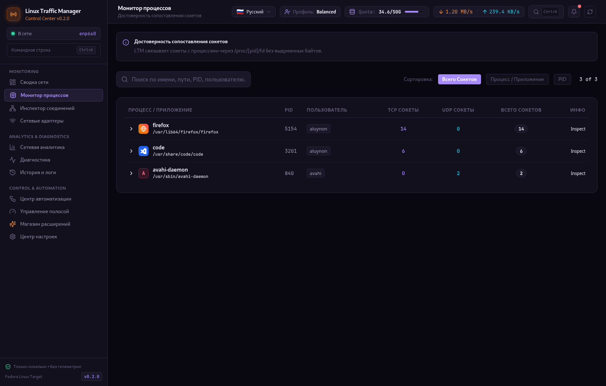
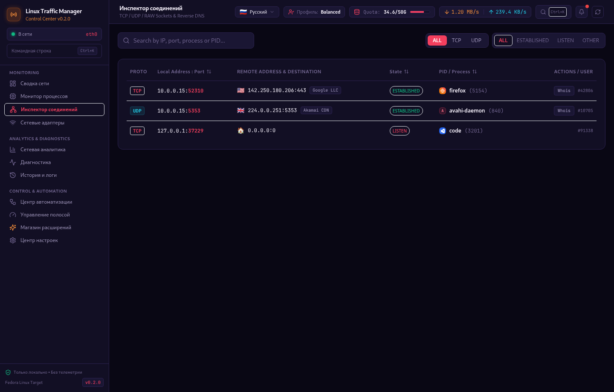
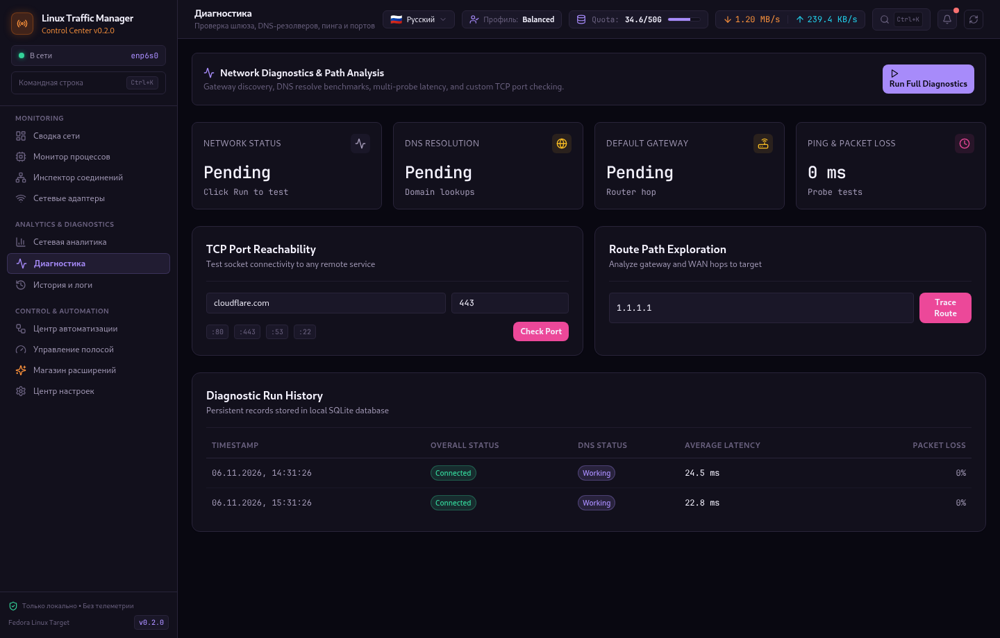
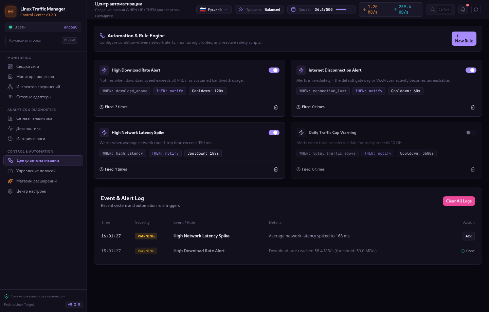

# Linux Traffic Manager (LTM)

<div align="center">

```
   __   _____ __  ___
  / /  /__   //  |/  /
 / /     / / / /|_/ / 
/ /___  / / / /  / /  
\____/ /_/ /_/  /_/   
```

**Understand your network.**

*A modern, lightweight and privacy-focused network traffic control center for Linux, built with Rust and Tauri 2.*

[](https://github.com/masyaslasher/linux-traffic-manager/actions/workflows/ci.yml)
[](LICENSE)
[](https://fedoraproject.org/)
[](https://www.rust-lang.org/)
[](#-поддерживаемые-языки-и-наречия--supported-languages--dialects)
[](https://github.com/masyaslasher/linux-traffic-manager/releases)

<br/>



</div>

---

## 🌟 Highlights

- **⚡ Performance First:** Asynchronous polling powered by Tokio. Minimal idle CPU overhead (<1%), bounded memory buffers, and zero unnecessary disk thrashing.
- **🛡️ 100% Offline & Private:** Local-only processing. No cloud connections, no user accounts, no telemetry, and no tracking. Your socket metadata never leaves your machine.
- **🎨 Warm Orange Signature Design:** Custom dark slate theme with luminous orange accents, glowing charts, smooth animations, and high-readability responsive dashboards.
- **🛒 Built-in Extension Store:** 
  - **10 Instant Themes:** Warm Orange, Cyberpunk Neon, Nordic Frost, Dracula Gothic, Emerald Matrix, Tokyo Nightfall, Solarized Teal, Crimson Velvet, Retro Synthwave 80s, Monokai Pro Studio, Paper Minimal Ivory. Instant 1-click toggle with zero downloads required!
  - **5 Functional Extensions:** GeoIP & Country Flags Inspector, Tracker & Telemetry Shield (DNS Guard), Data Quota & Tethering Guard, Deep Whois & Reverse ASN Probe, Network Speedtest Mini.
- **🌐 11 Reactive Languages (Instant Switching Without Reload):**
  - Русский (Russian)
  - English (US)
  - Deutsch (German)
  - Українська (Ukrainian)
  - Дореформенный Русскій (Pre-reform Russian with ѣ, ъ, ѳ, і)
  - Гутаръ Донскихъ Казаковъ (Don Cossack dialect)
  - Français (French)
  - Polski (Polish)
  - Medžuslovjansky (Interslavic)
  - Суржик (Surzhyk)
  - Русинськый (Rusyn)
- **🔍 Real System Metrics:** Direct Linux `/proc` and `/sys` integration. Real process socket attribution mapped via `/proc/[pid]/fd`.
- **🏷️ Smart Application Brand Icons:** Automatic recognition and brand iconography for Firefox, Chrome, Brave, Telegram, Discord, Steam, Spotify, Docker, VS Code, Git, OBS, Torrent clients, and more.
- **📊 8 Comprehensive Sections:**
  1. **Dashboard:** Real-time download/upload neon graphs, active interface status, peak speed memory, and rolling session statistics.
  2. **Applications:** Processes actively utilizing sockets with associated connection counts, download/upload attribution, and user context.
  3. **Connections:** Filterable and searchable table of TCP/UDP IPv4 & IPv6 connections with state indicators, GeoIP flags, and ASN details.
  4. **Interfaces:** Full Linux interface controller with MTU, MAC, speed duplex, carrier status, DNS servers, and error tracking.
  5. **Bandwidth:** Traffic shaping management, simulation profiles (Fiber, 4G, DSL, Gaming, Workstation), and limit controls.
  6. **Automation:** WHEN / IF / THEN rule engine for automated network alerts, speed thresholds, and disconnect triggers.
  7. **Diagnostics:** Automated DNS resolution, gateway reachability, ping latency, port reachability, and hop traceroute probes.
  8. **Store:** Built-in marketplace for 1-click theme switching and utility modules.
  9. **History & Analytics:** Historical traffic analytics backed by local SQLite storage with multi-series charts and CSV/JSON export.

---

## 📸 Галерея интерфейса / Screenshots & UI Showcase

<div align="center">

### 🛒 Встроенный магазин тем и расширений (Extension Store)


<br/>

### 🎨 Мгновенные темы оформления (Cyberpunk Neon & Emerald Matrix)
<p align="center">
  
  
</p>

<br/>

### 🔍 Монитор процессов и Инспектор соединений
<p align="center">
  
  
</p>

<br/>

### 🛠️ Сетевая диагностика и Центр автоматизации
<p align="center">
  
  
</p>

</div>

---

## 🌐 Поддерживаемые языки и наречия / Supported Languages & Dialects

LTM оснащён полностью реактивным движком интернационализации (i18n): **смена языка происходит мгновенно в 1 клик прямо в селекторе шапки приложения без перезагрузки интерфейса или потери данных**.

Поддерживаются **11 полноценных языков, диалектов и исторических наречий**:

| Флаг / Иконка | Язык / Наречие | Оригинальное название (Native Name) | Код | Описание и стилистика перевода |
|:---:|---|---|:---:|---|
| 🇷🇺 | **Русский** | Русский | `ru` | Современный литературный русский язык со всей технической сетевой терминологией. |
| 🇺🇸 | **English** | English (US) | `en` | Standard international English (*Network Dashboard, Process Monitor, Bandwidth Manager*). |
| 🇩🇪 | **Немецкий** | Deutsch | `de` | Точная немецкая инженерная терминология (*Netzwerkverkehr, Verbindungen, Überwachung*). |
| 🇺🇦 | **Украинский** | Українська | `uk` | Повна українська локалізація (*Мережева активність, Активні з'єднання, Інтерфейси*). |
| 📜 | **Дореформенный русский** | Дореформенный русскій | `ru_pre` | Дореформенный орфография Российской Империи с ятями (ѣ), ерами (ъ), ижицей и фитой (*Панель мониторинга, Соединенія, Скорость передачи*). |
| 🐎 | **Гутар донских казаков** | Гутаръ донскихъ казаковъ | `don_cossack` | Исторический диалект вольного донского казачества (*Сетевая справа, Приключки, Заставы, Гутарить*). |
| 🇫🇷 | **Французский** | Français | `fr` | Langue française standard (*Trafic réseau, Surveillance des processus, Outils de diagnostic*). |
| 🇵🇱 | **Польский** | Polski | `pl` | Język polski (*Aktywność sieciowa, Połączenia, Menedżer interfejsów*). |
| 🌐 | **Межславянский** | Medžuslovjanski | `interslavic` | Панславянский искусственный вспомогательный язык, понятный без изучения всем славянским народам (*Sěťova aktivnost, Pripojeńa, Nastavjeńa*). |
| 🌻 | **Суржик** | Суржик | `surzhyk` | Живой разговорный восточнославянский суржик (*Шо там з инетом, Проги в сети, Настройки інтерфейсів*). |
| 🏔️ | **Русинский** | Русиньскый | `rusyn` | Традиционный карпато-русинский литературный язык (*Сїтьова активіта, Зъєднаня, Діаґностіка*). |

---

## 🏛️ Architecture

```text
┌─────────────────────────────────────────────────────────────┐
│                      LTM Frontend (React 19 + Vite)         │
│  - Warm Orange Tailwind CSS + 10 Instant Color Themes       │
│  - Recharts Glowing Download/Upload Real-Time Graphs       │
│  - 10-Language Reactive I18n Engine (No Reload)             │
│  - Extension Store Context & Theme Injector                 │
│  - Typed IPC client (@tauri-apps/api)                       │
└──────────────────────────────▲──────────────────────────────┘
                               │ Tauri 2 IPC
┌──────────────────────────────▼──────────────────────────────┐
│                    src-tauri (Rust Desktop Host)            │
│  - Native window management (Wayland / X11)                 │
│  - Tauri command handlers                                   │
└──────────────────────────────▲──────────────────────────────┘
                               │
┌──────────────────────────────▼──────────────────────────────┐
│                  ltm-core (Modular Rust Engine)             │
│  ├── network/      -> /proc/net/dev, speed delta calculation│
│  ├── processes/    -> /proc/net/tcp*, /proc/[pid]/fd maps   │
│  ├── diagnostics/  -> Gateway discovery, DNS & ping tests   │
│  ├── storage/      -> Local SQLite database (v2 migrations) │
│  └── monitoring/   -> Tokio async interval loop             │
└─────────────────────────────────────────────────────────────┘
```

---

## 📦 Download & Installation

Pre-built binaries for Fedora, Ubuntu, Debian, Windows and generic Linux are available on the [Releases page](https://github.com/masyaslasher/linux-traffic-manager/releases).

### 🐧 Installing on Ubuntu / Debian / Pop!_OS / Linux Mint (.deb)

```bash
# Download the .deb from GitHub Releases:
sudo apt install ./linux-traffic-manager_0.2.0_amd64.deb
```

### 🔴 Installing on Fedora / RHEL / CentOS (.rpm)

```bash
# Download the .rpm from GitHub Releases:
sudo dnf install -y ./Linux\ Traffic\ Manager-*.x86_64.rpm
```

### 🪟 Windows (Portable .exe)

- Download `linux-traffic-manager-v0.2.0-portable.exe` directly or download `linux-traffic-manager-v0.2.0-windows-x86_64-portable.zip`.
- Run `linux-traffic-manager.exe` without any installation or administrator rights required!

### 📦 Generic Linux Portable Tarball

```bash
tar -xzf linux-traffic-manager-v0.2.0-x86_64.tar.gz
cd linux-traffic-manager-v0.2.0
./linux-traffic-manager
```

---

## 🛠️ Building From Source

### Prerequisites (Fedora)

```bash
sudo dnf install -y \
  webkit2gtk4.1-devel \
  gtk3-devel \
  libsoup3-devel \
  javascriptcoregtk4.1-devel \
  openssl-devel \
  librsvg2-devel
```

### Build & Run

```bash
# 1. Clone the repository
git clone https://github.com/masyaslasher/linux-traffic-manager.git
cd linux-traffic-manager

# 2. Install frontend dependencies
cd frontend
pnpm install
cd ..

# 3. Run Rust unit tests
cargo test --workspace

# 4. Launch in development mode
pnpm --prefix frontend tauri dev
```

### Build RPM Package

```bash
cargo tauri build --bundles rpm
```

The resulting package will be generated at `src-tauri/target/release/bundle/rpm/`.

---

## 🔒 Security & Linux Permissions

LTM runs entirely in **user space** without requiring `root` or `sudo`:
- Interface counters are read from world-readable `/proc/net/dev` and `/sys/class/net`.
- Connection sockets are read from `/proc/net/tcp`, `/proc/net/tcp6`, `/proc/net/udp`, `/proc/net/udp6`.
- Process correlation inspects the user's accessible `/proc/[pid]/fd` descriptors.
- Zero network telemetry: no metrics, IPs, or computer details are ever sent to remote servers.

---

## 🧪 Automated Testing

LTM features an extensive test suite verifying:
- Speed calculation under standard sampling intervals.
- 32-bit and 64-bit counter overflow handling.
- Monotonic reset detection when network interfaces change state.
- Hexadecimal IPv4 and IPv6 network address endianness conversion.
- Linux socket inode resolution to PID mapping.
- SQLite schema migrations (v1 and v2), inserts, and retention cleanup.
- Automation rule triggers and alert generation.

Run all tests via:
```bash
cargo test --workspace
```

---

## 📄 License

Licensed under the [MIT License](LICENSE).
